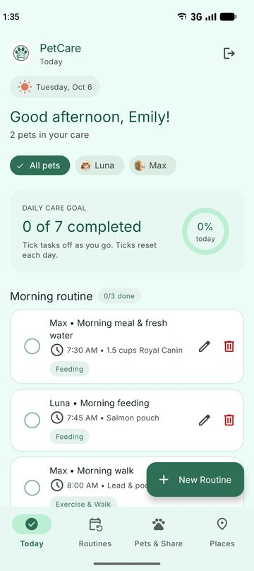
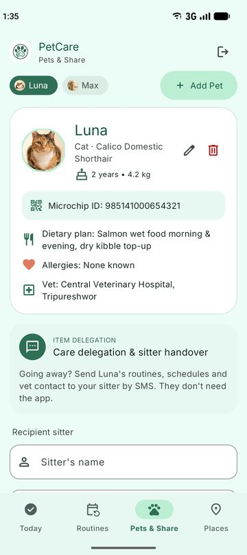
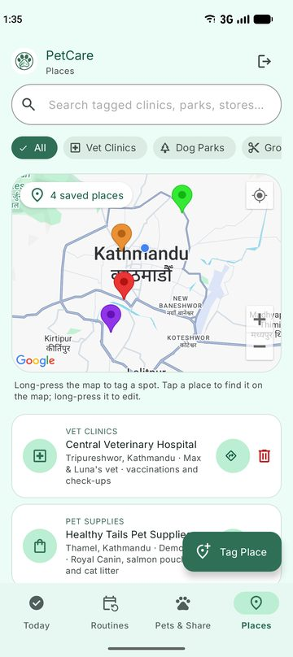
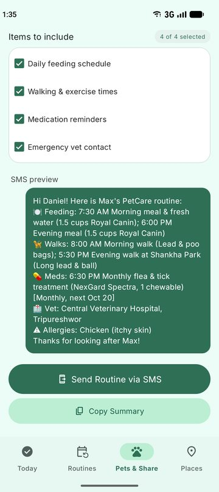
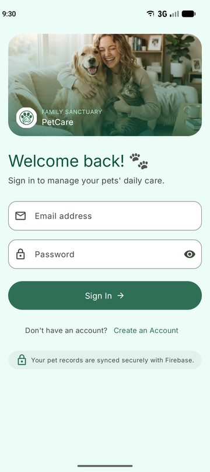
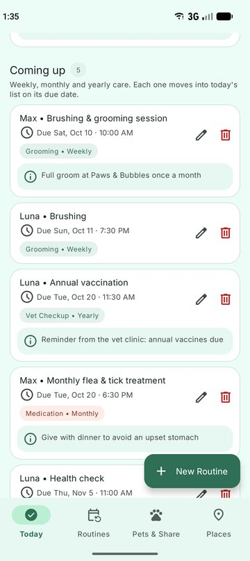
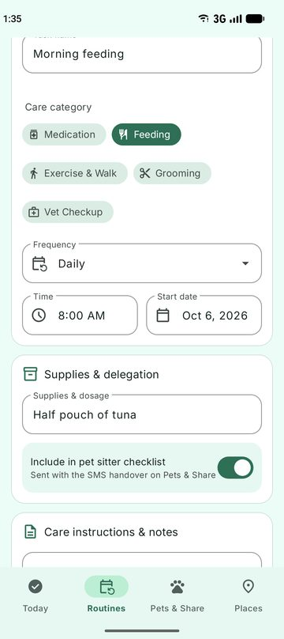
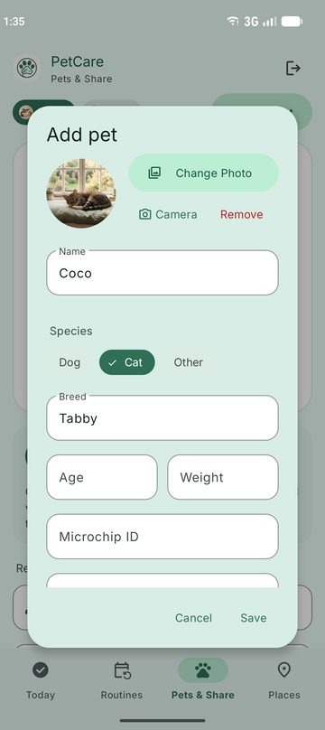

# PetCare

PetCare is a native Android app that keeps all of a family's pet care in one place. You can add your pets, plan their daily and repeating care, tick tasks off as you go, send a pet's routine to a sitter by SMS, and save your vet, groomer, dog park and pet shop on a map.

Built with Kotlin, XML layouts and Material Design 3, with Firebase Authentication and Cloud Firestore for accounts and data.

<p>
  
  
  
  
</p>

## Features

- **Accounts:** register and sign in with email and password (Firebase Authentication). Signed-in users skip straight to their dashboard.
- **Today:** a personal greeting, a daily progress ring, and morning and evening checklists. Tick a task to mark it done; ticks reset every day.
- **Coming up:** weekly, bi-weekly, monthly, quarterly and yearly routines are kept out of the daily list until their due date, and listed here with the next due date.
- **Routines:** create and edit care routines with a pet, category (feeding, exercise, grooming, medication, vet), time, start date, frequency, supplies, notes and a "send to sitter" switch. Delete with Undo.
- **Pets & Share:** add, edit and delete pets (deleting a pet also deletes its routines). Each pet has a profile with breed, age, weight, microchip, diet, allergies, vet and a photo.
- **Pet photos:** picked with the Android photo picker or taken with the camera, shrunk to 512 px and stored in Firestore as Base64.
- **SMS handover:** choose what to include (feeding, walks, medicines, vet contact), check the live preview, and open the phone's SMS app with the message filled in. No SMS permission is needed.
- **Places:** a Google map with colour-coded pins for vets, parks, groomers and pet shops. Long-press the map to tag a spot (the address is filled in automatically), search and filter places, and get directions in Google Maps.
- **Offline:** Firestore's cache keeps the app working without a connection and syncs changes when the phone is back online.

## Screenshots

<p>
  
  
  
  
</p>

## Tech stack

| Area | Used |
|---|---|
| Language | Kotlin |
| UI | XML layouts, View Binding, Material Components 1.10 (Material 3 theme), Inter font |
| Auth | Firebase Authentication (email / password) |
| Database | Cloud Firestore with offline persistence and security rules |
| Maps | Google Maps SDK for Android 19.2.0, Android `Geocoder` |
| Build | Android Gradle Plugin 9.4, Gradle 9.7, compileSdk / targetSdk 36, minSdk 31 (Android 12) |
| Tests | JUnit 4 |

## Project structure

```
app/src/main/java/np/com/sijandhakal/petcare/
├── SplashActivity.kt          # checks sign-in, routes to Login or Dashboard
├── LoginActivity.kt           # validation + Firebase sign in
├── RegisterActivity.kt        # validation + Firebase sign up + profile document
└── dashboard/
    ├── DashboardActivity.kt   # bottom navigation, top bar, sign out
    ├── data/
    │   ├── Models.kt          # Pet, CareTask, Place, Repeat (due-date logic)
    │   ├── PetCareRepository.kt  # all Firestore reads and writes
    │   ├── PetPhotos.kt       # resize + Base64 encode/decode, bitmap cache
    │   └── PlaceGeocoder.kt   # address <-> map position
    ├── fragments/
    │   ├── HomeFragment.kt    # Today tab
    │   ├── TaskFragments.kt   # Routines tab (create / edit routine)
    │   ├── PetsFragments.kt   # Pets & Share tab (profiles, photos, SMS)
    │   ├── PlacesFragment.kt  # Places tab (Google map)
    │   ├── CareTaskAdapter.kt
    │   └── PetChips.kt
    └── views/MapTouchWrapper.kt  # lets the map pan inside a scrolling page
```

## Data model

All data is stored per user, so the security rule only has to check that the signed-in user owns the path.

```
users/{uid}                 name, email, createdAt
users/{uid}/pets/{petId}    name, species, breed, age, weight, microchip, diet, allergies, vetName, vetPhone, photoBase64
users/{uid}/tasks/{taskId}  petId, title, category, hour, minute, startDateMillis, frequency, supplies, notes,
                            includeInSitterChecklist, doneOn (yyyy-MM-dd)
users/{uid}/places/{id}     name, category, address, notes, latitude, longitude
```

## Getting started

### Requirements

- Android Studio (recent version) with its bundled JDK
- An emulator or phone running Android 12 (API 31) or newer, with Google Play services for the map

### 1. Firebase

1. Create a project in the [Firebase console](https://console.firebase.google.com) and add an Android app with the package name `np.com.sijandhakal.petcare`.
2. Download `google-services.json` and put it in `app/`, replacing the existing one if you are using your own project.
3. **Authentication:** enable the **Email/Password** sign-in method.
4. **Firestore:** create a database, then publish the rules from [`firestore.rules`](firestore.rules):

   ```
   match /users/{userId}/{document=**} {
     allow read, write: if request.auth != null && request.auth.uid == userId;
   }
   ```

### 2. Google Maps key

1. In the [Google Cloud console](https://console.cloud.google.com), enable **Maps SDK for Android** and create an API key.
2. Add it to `local.properties` in the project root (this file is git-ignored, so the key is never committed):

   ```properties
   MAPS_API_KEY=your-key-here
   ```

   The build injects it into the manifest. It's best to restrict the key to the package name and your SHA-1 (`./gradlew signingReport`).

### 3. Run

Open the project in Android Studio, let Gradle sync, and run the `app` configuration. Or from the command line:

```bash
./gradlew :app:installDebug
```

## Tests

```bash
./gradlew :app:testDebugUnitTest
```

`RoutineScheduleTest` checks the scheduling rules: how frequency labels are read, and when daily, weekly, bi-weekly, monthly (including short months), quarterly and yearly routines are due. The report for this project also documents 30 manual test cases with screenshots, covering the UI, offline sync and the Firestore security rules.

## Known limitations and next steps

- No reminders or notifications yet (planned with WorkManager / AlarmManager).
- No expense tracking yet.
- Screens load data directly from the repository; moving to ViewModels would survive rotation without reloading.
- Base64 photos are simple but limited by Firestore's 1 MiB document size; Cloud Storage would scale better.
- No dark theme yet, and no automated UI (Espresso) tests.

## Acknowledgements

- The visual design was created with Google Stitch using its Material 3 design system.
- Icons from Google Material Symbols; Inter font by Rasmus Andersson (SIL Open Font License).

## Author

Sijan Dhakal
